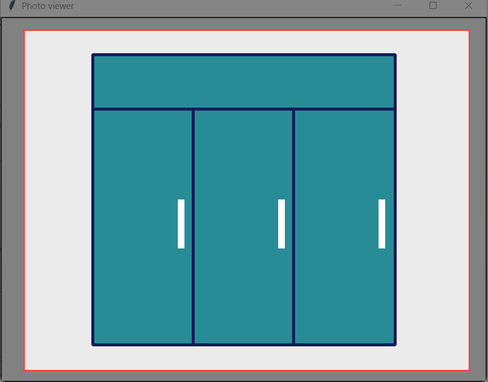
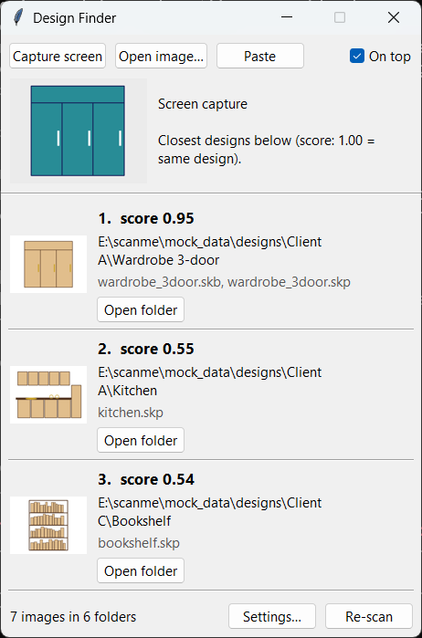

# Design Finder

**"Have I designed this before?"** Show Design Finder a design, either straight from your screen or from a photo, and it finds the folder where that design already lives, even if it's in different colors. It then opens the folder with the SketchUp master file (`.skp` / `.skb`) already selected.

- Free, **fully offline**, Windows. Nothing is uploaded, and screen captures are never saved.
- It sits on your screen as a small symbol, so it uses almost nothing until you tap it.
- It doesn't move, rename or reorganize your files. It only reads them.

| Resting: a small symbol you can drag anywhere | Capture: drag a frame around the design | Result: the matching folder |
|---|---|---|
|  |  |  |

In the example above, a **navy** wardrobe on screen was matched to the **brown** wardrobe saved in `Client A\Wardrobe 3-door` with score **0.95**. The next folder scored 0.55.

---

## Install (no Python needed)

1. **Get `DesignFinder.exe`.** Build it once on a PC with Python (see [Development](#development)): `python scripts\build_exe.py` creates `dist\DesignFinder.exe` (about 75 MB). Copy it by USB stick or Google Drive. WhatsApp and e-mail often block `.exe` files.
2. **Give it its own folder,** for example `C:\Tools\DesignFinder\`. Don't use `Program Files`. Settings and the index are saved **next to the exe**, so the folder must be writable. If it isn't, they go to `%LOCALAPPDATA%\DesignFinder`.
3. **Start it** by double-clicking. Windows may say *"Windows protected your PC"* because the exe isn't code-signed. Click **More info → Run anyway**, once. A blue symbol appears at the right edge of the screen after a few seconds.
4. **Choose your design folders.** Tap the symbol. On the first start, **Settings** opens: click **Add folder…** for each top folder (sub-folders are included), then **Save and scan**. The first scan reads every image once. Later scans only look at new or changed files.
5. **Optional:** tick **Start with Windows** in Settings, so the symbol is always there after login.

**Update:** replace `DesignFinder.exe`. Your settings and index stay. **Uninstall:** untick *Start with Windows*, then delete the folder.

## Daily use

| You want to… | Do this |
|---|---|
| Check a design that's on screen (WhatsApp Web, a PDF, an e-mail, a website) | Right-click the symbol → **Capture screen**, or tap it → **Capture screen**. The screen freezes. Drag a frame around the design and let go. **Esc** or right-click cancels. |
| Check a saved photo | Tap the symbol → **Open image…**. (Explorer's *Open with* → `DesignFinder.exe` also works, but only when Design Finder isn't already running.) |
| Use something you copied | Copy an image (or an image file in Explorer), tap the symbol, press **Ctrl+V** |
| Go to the master file | Click **Open folder** on a result. Explorer opens with the newest `.skp`/`.skb` selected, ready to open or drag into SketchUp. |
| Put it away | Close the window (X) or press **Esc**. It shrinks back to the symbol and forgets the search. |
| Move the symbol | Drag it anywhere, even to another monitor. It remembers the spot. |
| Quit completely | Right-click the symbol → **Exit Design Finder** |

New designs are picked up automatically each time you open the window. **Re-scan** does the same thing on demand.

### What stays private

- **Screen captures exist only in memory.** The frozen screen is released as soon as you let go of the mouse, and the cropped part is released when you close the window. Nothing is written to disk or to the clipboard.
- The index (`index.db`) contains file paths and short lists of numbers (fingerprints), **not copies of your images**.
- The app makes no internet connections at all.

## When can you trust the result?

Every result shows a **score**, a thumbnail and the folder. Read them like this:

| What you see | What it means | What to do |
|---|---|---|
| **#1 scores about 0.9 or higher, and is far ahead of #2** (for example 0.95 vs 0.55) | It's the same design: a copy, resized, WhatsApp-compressed, screenshotted, recolored or in dark mode | Trust it and click **Open folder** |
| **#1 scores about 0.6–0.8 and is only a little ahead of #2** | Probably the same design with changes (an extra door or shelf, different proportions) | Compare the thumbnails before opening |
| **Every score is low (about 0.5 or less) and close together** | This design is **probably not in your folders yet** | Treat it as new. If unsure, glance at #1. |

These ranges come from the sample library in `mock_data/`, which you can test yourself (see below):
- Same designs in different colors, dark mode, WhatsApp quality and screenshots scored **0.78–0.95**.
- Edited designs scored **0.63–0.90**.
- A design that wasn't in the library scored **0.38**.

Every known design came out on top (7 of 7). With your own library the exact numbers will differ a little, so do the 5-minute check below once.

**It works best with:**
- Drawings, renders and elevations seen **from the front**, like the images in your folders
- **One design per capture**, framed loosely (some empty space around it is fine)
- Any colors or color scheme, WhatsApp-compressed copies, screenshots, and resized or cropped-margin versions

**Be careful with:**
- **Photos of finished furniture taken at an angle.** Perspective changes the shape. Try it, but check the thumbnails.
- **Capturing only part of a design** (half a wardrobe), or **several designs at once**. Frame the whole design and nothing else.
- **Tiny captures** (a thumbnail of a thumbnail). Zoom in first, then capture.
- **Designs that look nearly the same**, such as two very similar cabinets. Both folders will score high, so compare the thumbnails.

### 5-minute check on a new computer

1. Capture a design that's **definitely** in your folders. Its folder should be #1 at about 0.9 or more.
2. Capture the same design from a **WhatsApp chat** or in **other colors**. It should still be #1.
3. Capture something you've **never** designed. All scores should be clearly lower.
4. Click **Open folder** and check that Explorer selects the SketchUp file.

If these four look right, you can rely on it day to day. If one goes wrong, note the image and the folder it should have found. That's exactly what's needed to improve the matching.

## Try it with the sample library

`mock_data/` contains a small sample library you can use to get a feel for the tool before using it on real folders:
- Six furniture designs (wardrobe, kitchen, reception desk, TV unit, bed, bookshelf) across three clients, in **PNG**, **WhatsApp JPEG** (`IMG-…-WA….jpg`) and **WEBP**. Each folder has `.skp`/`.skb` files to select. These are small stand-in files, not real models.
- `mock_data/queries/`: the same designs recolored, in dark mode, WhatsApp-compressed, as a screenshot, with an extra shelf or door, plus one design that is **not** in the library.

To try it, add `mock_data\designs` as a folder in **Settings**, then **Open image…** any file from `mock_data\queries`. Or open one on screen and **Capture** it.

To score all of them at once (needs Python, see [Development](#development)):

```powershell
python scripts\eval_queries.py
```

| Search image | Expected folder | Score | 2nd best | Result |
|---|---|---|---|---|
| wardrobe, navy colors | Wardrobe 3-door | 0.95 | 0.55 | ✅ |
| kitchen, WhatsApp JPEG + pastel | Kitchen | 0.63 | 0.54 | ✅ |
| reception desk, dark mode | Reception desk | 0.78 | 0.69 | ✅ |
| TV unit, screenshot with margins | TV unit | 0.95 | 0.54 | ✅ |
| bed, WhatsApp JPEG + dark | Bed with storage | 0.93 | 0.57 | ✅ |
| bookshelf with 5 shelves (saved one has 4) | Bookshelf | 0.90 | 0.63 | ✅ |
| wardrobe with 4 doors (saved one has 3) | Wardrobe 3-door | 0.64 | 0.58 | ✅ |
| coffee table (not in library) | — | 0.38 | | ✅ correctly low |

The same script works on your own examples. Put them in `data\` (ignored by git) as `designs\` plus `queries\expected.csv`, and run `python scripts\eval_queries.py data`.

## How the matching works

No AI service and no internet. Every image goes through the same steps, and **no image is converted or saved as another file**:

1. **Read.** PNG, JPG and WEBP all become the same grid of pixels. Transparent areas become white.
2. **Remove color.** The image is converted to grayscale, so a blue wardrobe and a brown wardrobe start to look alike.
3. **Trim margins.** The plain background around the design is cut away. This repeats, because a screenshot has two margins: the screen around the picture, and the picture's own background. A small even margin is then added back, and everything is resized to the same size.
4. **Even out contrast** (CLAHE), so pale and strong color schemes end up alike.
5. **Two views of the design:** an **edge map** (just the lines and outlines, which don't care about color) and the **gray image** itself.
6. **Fingerprint.** Each view is shrunk and run through a **DCT** (the math JPEG uses). The lowest 16×16 frequencies are kept, which describe the overall layout and ignore tiny details. That gives 255 numbers per view.
7. **Compare.** The score is the **cosine similarity** of the fingerprints, averaged over both views: 1.0 means identical, around 0 means unrelated. Inverted colors (dark mode) count as the same design.

Fingerprints are stored in a small local SQLite database, so a search compares one new fingerprint against all stored ones in a fraction of a second. Results are grouped by folder, and each folder shows its best-matching image.

## Development

```powershell
py -3.11 -m venv .venv
.venv\Scripts\activate
pip install -e ".[dev]"

python -m designfinder.bubble                 # run from source (the symbol)
python -m designfinder.app [image]            # run from source with the window already open
python scripts\build_exe.py                   # build dist\DesignFinder.exe

pytest                                        # all tests
pytest tests/test_ui.py::test_capture_returns_only_the_framed_region   # one test
python scripts\eval_queries.py [data_dir]     # score queries/expected.csv against designs/
python scripts\make_mock_data.py              # regenerate mock_data\

python -m designfinder index "D:\Designs"     # command-line index …
python -m designfinder search photo.jpg       # … and search (uses data\index.db)

bandit -q -r src scripts packaging            # static security scan
pip-audit --skip-editable                     # known-vulnerable dependencies
```

| Path | What it does |
|---|---|
| `src/designfinder/bubble.py` | The floating symbol (entry point). Loads only tkinter until tapped. |
| `src/designfinder/app.py` | The search window, settings, background scanning |
| `src/designfinder/capture.py` | Freeze screen → drag a frame → crop, all in memory |
| `src/designfinder/fingerprint.py` | Image → fingerprints (steps 1–6) |
| `src/designfinder/search.py` | Comparing fingerprints (step 7), grouping by folder |
| `src/designfinder/index.py` | SQLite index, incremental re-scan |
| `src/designfinder/settings.py`, `startup.py`, `screen.py`, `icon.py` | Settings file, Start with Windows, screen geometry, app icon |
| `scripts/` | Sample-data generator, evaluation, exe build |
| `tests/` | Unit, UI-flow and end-to-end tests |

CI (`.github/workflows/ci.yml`) runs the tests, the evaluation, `bandit` and `pip-audit` on Windows for every push.

## Security

See [SECURITY.md](SECURITY.md). In short:
- Offline, with no network code.
- No shell. The only program started is `%WINDIR%\explorer.exe` by full path.
- Parameterized SQL only, a validated settings file, and no `eval` or `pickle`.
- Start with Windows uses the per-user Run key, so no admin rights are needed.
- Folder scanning doesn't follow symbolic links.

## Roadmap

1. ~~Index and search from the command line~~
2. ~~JPG/WEBP, sample library, evaluation, security checks~~
3. ~~Window, `.exe`, install guide~~
4. ~~Floating symbol, screen capture, Start with Windows, CI~~
5. Next: tune the score ranges on a real design library and show a clear **"Found" / "Looks new"** label
